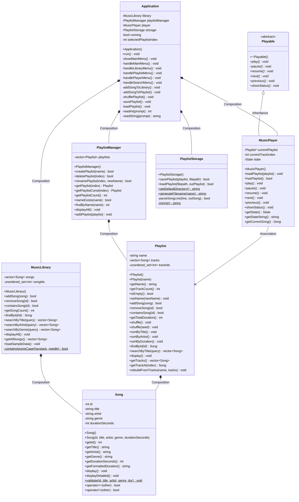

# Class Diagram — Smart Playlist Synthesizer

This diagram represents the actual class relationships in the implemented codebase.

## Complete Class Diagram

## Relationship Explanations

| Relationship | Type | Explanation |
|---|---|---|
| `Playable` ← `MusicPlayer` | **Inheritance** | MusicPlayer IS-A Playable; overrides pure virtual methods |
| `Application` → `MusicLibrary` | **Composition** | Application owns and manages the library's lifetime |
| `Application` → `PlaylistManager` | **Composition** | Application owns and manages all playlists |
| `Application` → `MusicPlayer` | **Composition** | Application owns the player instance |
| `Application` → `PlaylistStorage` | **Composition** | Application owns the storage handler |
| `PlaylistManager` → `Playlist` | **Composition** | Manager contains zero or more Playlist objects |
| `MusicLibrary` → `Song` | **Composition** | Library contains zero or more Song objects |
| `Playlist` → `Song` | **Composition** | Playlist contains zero or more Song objects (copies) |
| `MusicPlayer` → `Playlist` | **Association** | Player references a Playlist (non-owning pointer) |

## Key Design Decisions

1. **Songs are stored by value** in both the library and playlists. This means playlists have their own copies, and changes to the library don't unexpectedly affect playlists.

2. **MusicPlayer uses a non-owning pointer** (`const Playlist*`) to reference the active playlist. The playlist's lifetime is managed by `PlaylistManager`, and the player must not outlive the playlist it references.

3. **Playable is a genuine abstraction** — it defines what any "playable" entity must support, allowing future extension (e.g., a `RadioPlayer` could also implement `Playable`).
