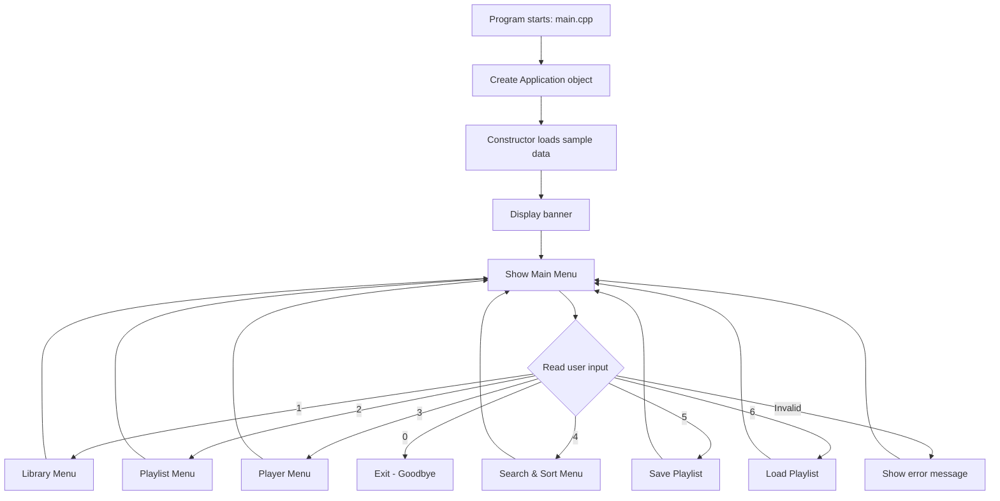
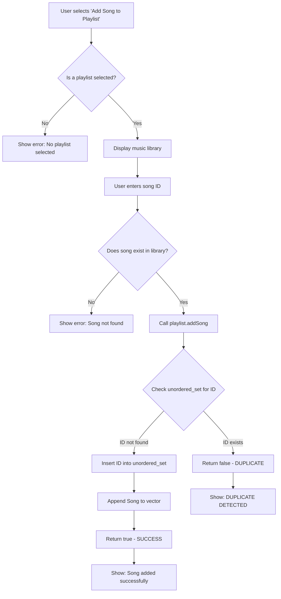
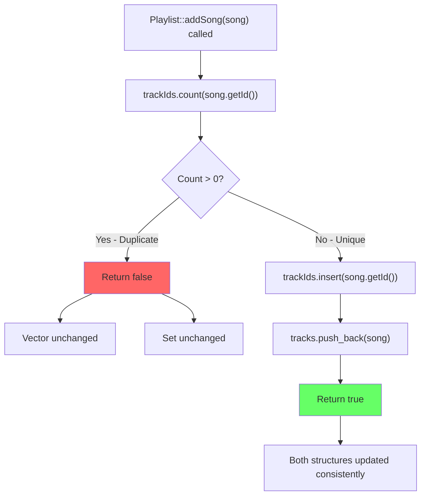
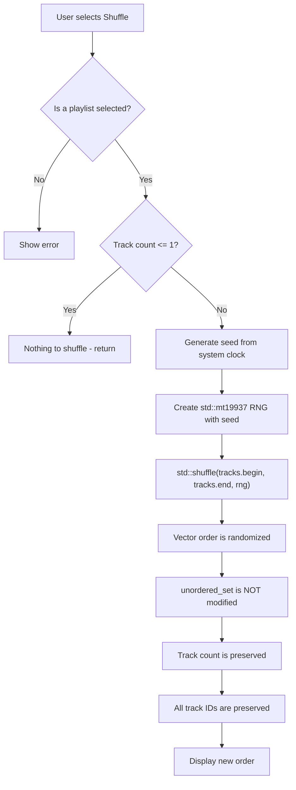
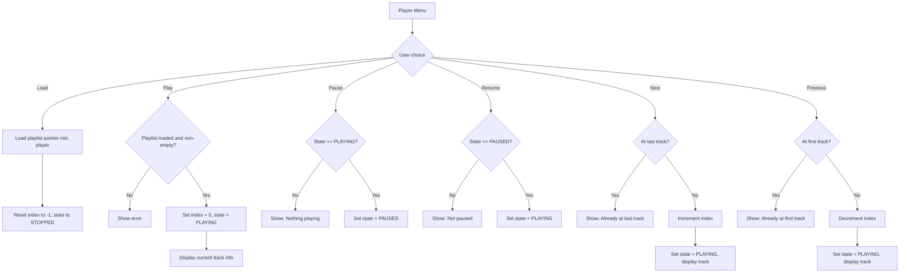
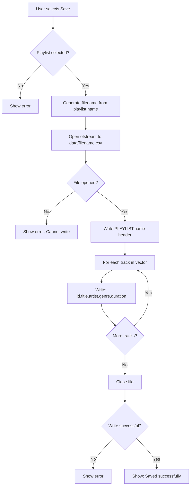
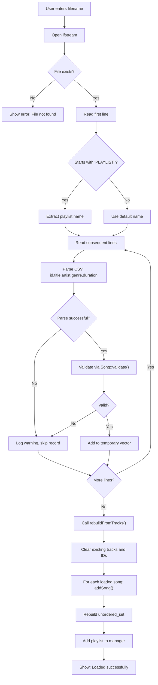

# Flowcharts — Smart Playlist Synthesizer

All flowcharts represent the actual execution paths in the implemented codebase.

---

## 1. Overall Application Execution

---

## 2. Adding a Song to a Playlist

---

## 3. Duplicate Detection Logic

---

## 4. Playlist Shuffling

---

## 5. Playback Navigation

---

## 6. Saving and Loading Playlists

### Save Flow

### Load Flow

